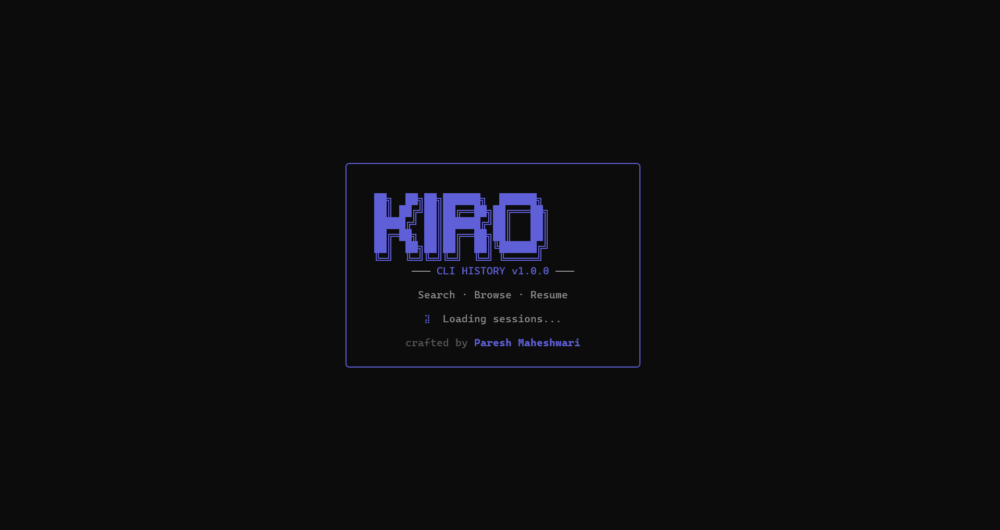
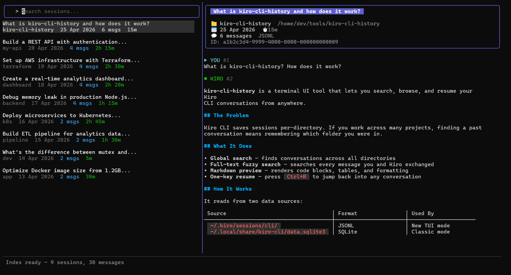
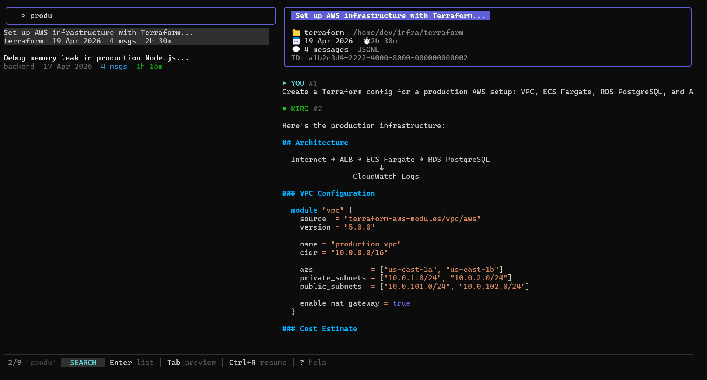
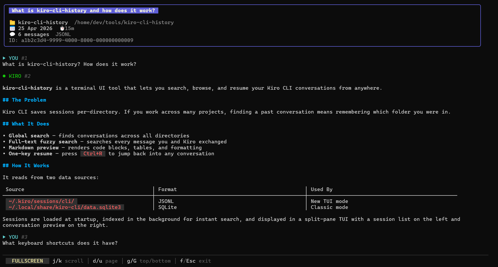
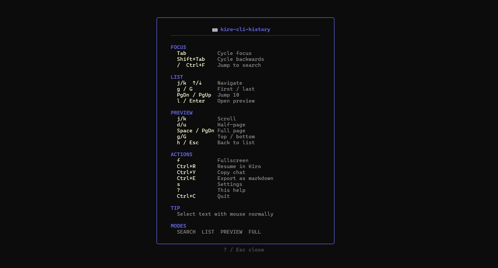
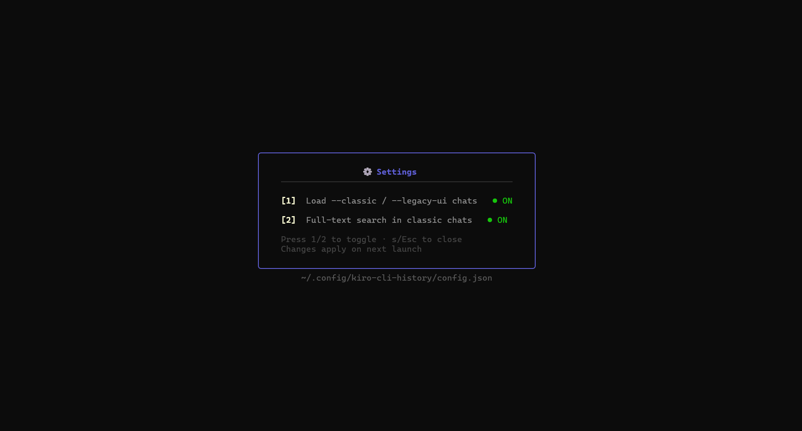

# kiro-cli-history

[](https://github.com/Paresh-Maheshwari/kiro-cli-history/actions/workflows/ci.yml)
[](https://github.com/Paresh-Maheshwari/kiro-cli-history/releases/latest)
[](https://go.dev)
[](LICENSE)

A fast terminal UI for searching, browsing, and resuming [Kiro CLI](https://kiro.dev/docs/cli/) conversations.

> **Read-only** — never writes to or modifies your Kiro CLI session data.

## The problem

Kiro CLI saves sessions per-directory. If you work across many projects, finding a past conversation means remembering which folder you were in. `kiro-cli-history` gives you **global text search across sessions** — regardless of directory.

## Screenshots

### Splash screen


### Main view — session list with markdown preview


### Text search — filter sessions in real-time


### Fullscreen — expanded preview for wide content


### Help — all keyboard shortcuts


### Settings — configure data sources


## Features

- **Global search** — find conversations across all directories
- **Full-text search** — case-insensitive substring matching across visible messages, titles and directories
- **Markdown preview** — rendered markdown, code blocks, tables
- **Workspace tree** — sessions start grouped by directory (collapsible); press `v` to switch to a flat list
- **Subagents & rewinds grouped** — subagent sessions nest under the chat that started them (`⑂`), rewound copies collapse into one row (`↺`)
- **Fullscreen mode** — press `f` for wide content like tables
- **One-key resume** — `Ctrl+R` to continue a conversation in Kiro CLI
- **Copy to clipboard** — `Ctrl+Y` to copy an entire conversation
- **Export as markdown** — `Ctrl+E` to save conversation as `.md` file
- **Text selection** — select and copy text directly from the preview
- **All session formats** — reads V3 sessions, V2 JSONL (TUI mode), and SQLite (--classic / --legacy-ui), with migrated copies deduplicated
- **Background loading** — indexing, previews, copy and export keep the interface responsive
- **Configurable** — SQLite loading, full-text indexing, default view, subagent/rewind grouping via settings (`s`)

## Session data locations

Reads from (all read-only):
- `~/.kiro/sessions/<workspace>/<session>/` — V3 `session.json` metadata and `messages.jsonl` conversations
- `~/.kiro/sessions/cli/` — V2 JSONL sessions (TUI mode)
- `~/.local/share/kiro-cli/data.sqlite3` — SQLite sessions (Linux, --classic / --legacy-ui)
- `~/Library/Application Support/kiro-cli/data.sqlite3` — SQLite sessions (macOS)
- `%USERPROFILE%\.kiro\sessions\` (V3 and V2) and `%LOCALAPPDATA%\kiro-cli\data.sqlite3` — Windows

`KIRO_HOME` and `XDG_DATA_HOME` are respected if set.

## Install

### One-liner (prebuilt binary, no Go needed)

```bash
curl -sL https://raw.githubusercontent.com/Paresh-Maheshwari/kiro-cli-history/main/get.sh | bash
```

Auto-detects your OS (Linux/macOS) and architecture (amd64/arm64), requires a matching SHA-256 checksum, checks the binary version, and installs to `~/.local/bin/` (override with `INSTALL_DIR=...`). Failed verification leaves the previous binary in place.

### Windows (PowerShell)

```powershell
irm https://raw.githubusercontent.com/Paresh-Maheshwari/kiro-cli-history/main/install.ps1 | iex
```

Detects amd64/arm64, verifies the SHA-256 checksum, installs to `%LOCALAPPDATA%\Programs\kiro-cli-history`, and adds it to your user `PATH`. From a cmd prompt or Explorer you can run `install.cmd` from the repo instead.

### Updating

```bash
kiro-cli-history update          # download and install the latest release
kiro-cli-history update --check  # only check
```

The update downloads the binary for your platform from GitHub Releases, verifies it against the release's `checksums.txt`, checks that it runs, then replaces the current binary. If you installed to a system directory (e.g. `/usr/local/bin`), run it with the same permissions (`sudo`). Set `GITHUB_TOKEN` if you hit the API rate limit.

### From source (requires Go 1.26.10+ and a C compiler for SQLite)

```bash
git clone https://github.com/Paresh-Maheshwari/kiro-cli-history.git
cd kiro-cli-history
bash install.sh
```

## Usage

```bash
kiro-cli-history            # all sessions, everywhere
kiro-cli-history --here     # only sessions from the current directory
kiro-cli-history --cwd DIR  # only sessions from DIR
```

Run from anywhere. By default it searches globally. `--here` limits the browser to conversations started in the current directory, which also opens much faster because only those chats are indexed.

Use a terminal at least 60 columns wide and 12 rows tall. Smaller windows show a resize prompt; `Ctrl+C` always quits, including inside help and settings.

### Keyboard shortcuts

| Key | Action |
|-----|--------|
| `/` or `Ctrl+F` | Focus search bar |
| `Tab` / `Shift+Tab` | Cycle focus: search → list → preview |
| `j` / `k` or `↑` / `↓` | Navigate list or scroll preview |
| `l` / `Enter` | Open preview pane |
| `h` / `Esc` | Back to list |
| `v` | Toggle list/tree view |
| `h` / `l` (tree) | Collapse / expand; `h` again goes to the parent |
| `f` | Fullscreen preview |
| `d` / `u` | Half-page scroll in preview |
| `g` / `G` | Jump to top / bottom |
| `Ctrl+R` | Resume session in Kiro CLI |
| `Ctrl+Y` | Copy conversation to clipboard |
| `Ctrl+E` | Export conversation as markdown |
| `s` | Settings |
| `?` | Help overlay |
| `Ctrl+C` | Quit |

### Modes

The status bar shows the current mode:

- **SEARCH** — type to filter sessions by title, directory, or content
- **LIST** — browse and select sessions
- **PREVIEW** — read conversation with markdown rendering
- **FULLSCREEN** — expanded preview for wide content

### Settings

Press `s` to open settings. Config saved to `~/.config/kiro-cli-history/config.json`:

| Setting | Default | Description |
|---------|---------|-------------|
| Load classic mode chats | ON | Load SQLite sessions from --classic / --legacy-ui |
| Full-text search classic chats | OFF | Index classic chat content (slow on large DBs) |
| Default sidebar view | tree | Start in list or tree view |
| Nest subagents under parent | ON | Hide subagent sessions from the top level; browse them in tree view |
| Collapse rewind versions | ON | Show only the newest copy of a rewound chat |

### Searching

Type in the search bar to search across:
- Session titles
- Working directories
- Visible conversation messages (enable classic full-text indexing for SQLite chats)

Search is case-insensitive. Multiple words are AND-matched (`deploy aws` finds sessions containing both words).

The content index retains up to 8 MiB per session and 128 MiB overall. If either limit is reached, the status bar reports how many sessions have limited search. Titles and directories remain searchable.

JSONL conversations are streamed regardless of total file size, including files larger than 100 MiB. Reading uses the file length at the start, so an active conversation cannot make the operation run indefinitely. Known non-message records are discarded while streaming. Other individual JSONL records larger than 64 MiB are skipped with a partial-read notice; later messages remain readable. Metadata and classic SQLite values retain a 100 MiB limit because those formats are decoded as whole objects. Session files are never modified.

### Subagents and rewinds

Recent Kiro CLI versions create extra sessions:

- **Subagents** — each delegated task is saved as its own session linked to the chat that started it.
- **V3 workflow steps** — nested under their owning chat, using the same subagent grouping.
- **Rewinds** — rewinding a chat saves a new copy linked to the previous one.

By default each chat shows as a single row. The badges `↺3` (older rewind versions) and `⑂6` (subagents) tell you what's nested; press `v` for tree view and `l` on the row to browse them. Search still finds text inside nested sessions and shows the row they belong to. Turn either option off in settings (`4`, `5`) to list every session separately.

The workspace tree keeps nested workflow steps under their immediate parent.
Search expands matching groups, and a child whose parent is missing remains
visible. Multi-workspace chats appear in each workspace; `--here` / `--cwd`
show only the requested workspace. Existing saved view preferences are respected.

### Export

Press `Ctrl+E` to export the current conversation as a Markdown file. Files are saved to `~/kiro-exports/` with unique timestamped names; existing files are never overwritten. On Unix the directory is restricted to its owner (`0700`) and new files use `0600`. On Windows, access follows the user profile's ACLs.

Copy/export preserve the original message text, including text escaped for safe terminal display. Clipboard copying is limited to 32 MiB and external clipboard tools time out after three seconds. Export streams messages to disk. Conversations without a legacy resume ID remain readable and exportable, but cannot be resumed from the browser.

### Preview limits

All previews load in the background and cancellation is checked even while reading hidden tool traffic. Messages larger than 8 KiB use plain text to avoid expensive Markdown formatting. A preview displays up to 512 KiB of message text within a 4 MiB rendered-output budget, with an explicit notice when limited. A message larger than the preview budget still shows its beginning; copy/export can retrieve the full readable conversation. The preview cache retains at most 20 MiB. Terminal control sequences are neutralized without changing stored session files.

## How it works

Kiro CLI stores conversations in multiple formats:

| Format | Location | Used by |
|--------|----------|---------|
| V3 JSONL | `~/.kiro/sessions/<workspace>/<session>/session.json` + `messages.jsonl` | V3 agent engine (`kiro-cli --v3`) |
| V2 JSONL | `~/.kiro/sessions/cli/*.json` (metadata) + `*.jsonl` (messages) | V2 TUI mode |
| SQLite v2 | `data.sqlite3` → `conversations_v2` | `kiro-cli --classic` / `--legacy-ui` |
| SQLite v1 | `data.sqlite3` → `conversations` | Older classic versions |

`kiro-cli-history` reads all formats and presents them in a unified view.

V3 previews and search include user messages and visible assistant replies;
reasoning, tool results, and internal context are omitted. Conversations migrated
from V2 appear once, using the V3 copy. Resume selects the V3 engine for V3 sessions.
For multi-workspace V3 sessions, `--here` / `--cwd` match any saved workspace.
See [V3 format notes](docs/kiro-v3-format.md) for the observed metadata,
message events, and grouping rules.

## Platforms

Prebuilt binaries for every release:

| OS | amd64 | arm64 |
|----|-------|-------|
| Linux (glibc 2.35+) | ✓ | ✓ |
| macOS | ✓ (Intel) | ✓ (Apple Silicon) |
| Windows | ✓ | ✓ (classic-mode SQLite chats not supported) |

Clipboard uses `wl-copy`/`xclip`/`xsel` on Linux, `pbcopy` on macOS, and the native clipboard on Windows.

## Validation

Run `go test -race ./...`, `go vet ./...`, and `go run golang.org/x/vuln/cmd/govulncheck@v1.9.0 ./...`.

Release builds exercise the native installer against staged binaries before publishing. The installer test inputs are `KIRO_CLI_HISTORY_RELEASE_DIR` (directory containing the platform binary and `checksums.txt`) and `KIRO_CLI_HISTORY_VERSION`. Without a staged directory, installers resolve one release version before downloading its binary and checksum. Release notes are in [CHANGELOG.md](CHANGELOG.md).

## License

MIT — crafted by [Paresh Maheshwari](https://github.com/Paresh-Maheshwari)
